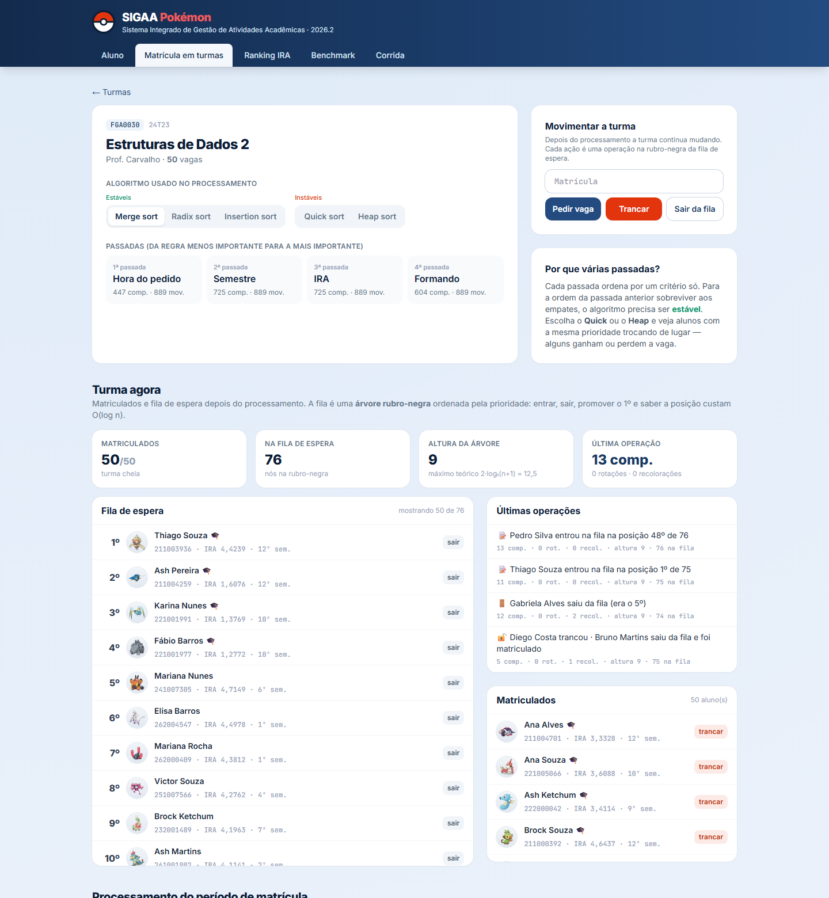
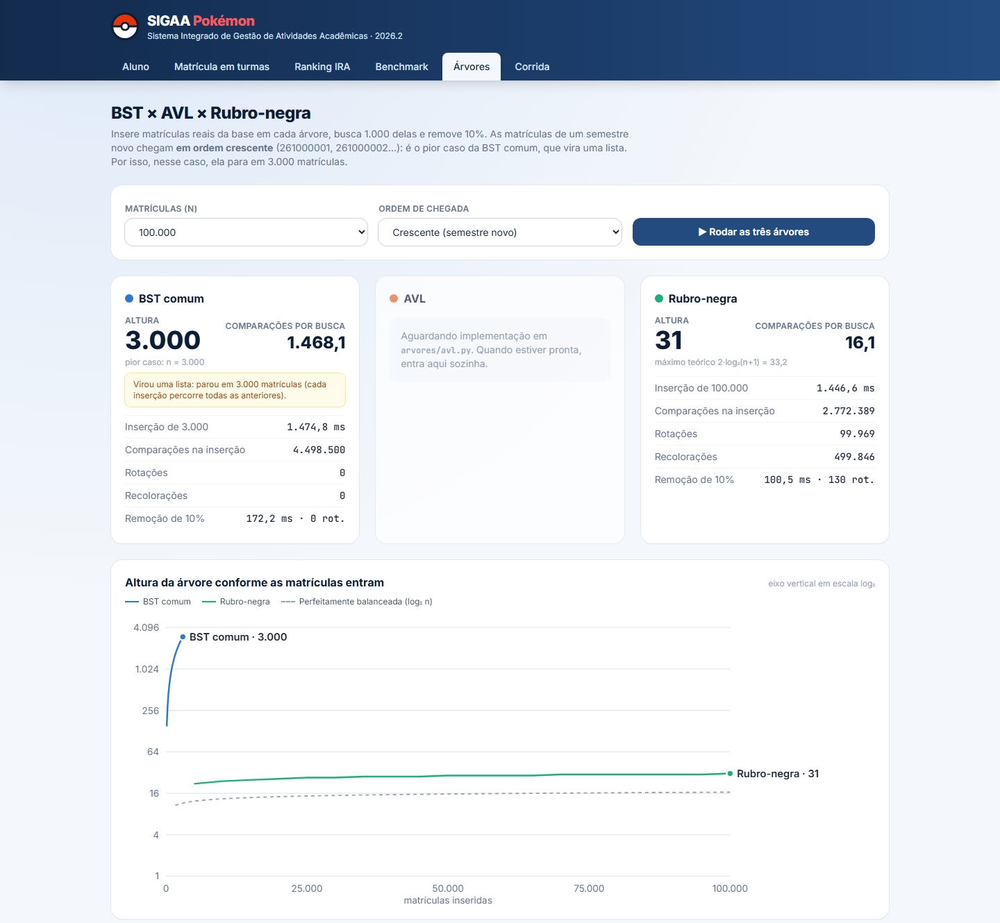

# G31_Arvores_EDA2-2026.2
Repositório dedicado ao Trabalho 3 (Árvores Balanceadas) de Estruturas de Dados 2 do 2º semestre de 2026.

https://youtu.be/y28rO-B_7yA - apresentação

## Alunos
| Matrícula | Nome |
|-----------------------|---------------------|
| 23/2000660 | ANA LUISA VIEIRA NUNES |
| 22/2006113 | JOÃO MARCOS MORAES DE ANDRADE |

## Descrição do projeto

Continuação do [Trabalho 1 (Busca)](https://github.com/eda2-2026/G31_Busca_EDA2-2026.2) e do [Trabalho 2 (Ordenação)](https://github.com/eda2-2026/G31_Ordenacao_EDA2-2026.2). O **SIGAA Pokémon** simula a matrícula em turmas de uma universidade com 100 mil alunos, e cada aluno tem um Pokémon parceiro.

No trabalho 2, o período de matrícula era processado de uma vez só, ordenando os pedidos por prioridade. Na vida real, porém, a turma **continua mudando depois do processamento**: alunos trancam, desistem e fazem pedidos novos. Este trabalho resolve esse problema com uma **fila de espera dinâmica guardada numa árvore rubro-negra**.

### O problema: a fila de espera da turma

- **Pedido novo:** se sobrou vaga, o aluno é matriculado direto. Senão, entra na fila **no lugar que a prioridade dele manda**. Um formando com IRA alto passa na frente de quem já estava esperando.
- **Trancamento:** a vaga abre e o **1º da fila é promovido na hora**.
- **Desistência:** o aluno sai da fila e todos atrás dele sobem uma posição.
- **"Qual a minha posição na fila?":** o aluno vê a posição dele na consulta, e ela é sempre atual.

A prioridade é a mesma do trabalho 2: **formando → maior IRA → semestre mais avançado → pedido mais cedo**. Essa tupla é a **chave** da árvore, então a menor chave é o 1º da fila.

### Por que uma árvore e não uma lista ordenada?

| Operação | Lista ordenada | Reordenar tudo a cada mudança | **Rubro-negra** |
|---|---|---|---|
| Pedido novo entra no lugar certo | O(n) (deslocar) | O(n log n) | **O(log n)** |
| Promover o 1º da fila | O(n) (deslocar) | O(1) | **O(log n)** |
| Desistência no meio da fila | O(n) | O(n log n) | **O(log n)** |
| Posição de um aluno na fila | O(n) | O(n) | **O(log n)** |

A última linha só é O(log n) porque cada nó guarda o **tamanho da sua subárvore** (árvore de estatística de ordem). Para saber a posição de uma chave, basta descer da raiz somando o tamanho das subárvores esquerdas que ficam para trás. O mesmo campo responde `k_esimo(1)`, que é "quem é o 1º da fila".

## Prints

**Fila de espera na página da turma:** a fila numerada, os matriculados com o botão de trancar, e o custo de cada operação na árvore (comparações, rotações, recolorações), junto com a altura atual comparada ao máximo teórico.



**Consulta do aluno:** a situação atual em cada turma. Na fila, a posição vem da árvore em O(log n).


## As árvores

Todas ficam em [`arvores/`](arvores) e compartilham a mesma interface ([`base.py`](arvores/base.py)): `inserir`, `remover`, `buscar`, `posicao`, `k_esimo`, `intervalo`, `em_ordem` e `altura`, além de métricas de comparações, rotações e recolorações.

| Arquivo | Árvore | Quem fez |
|---|---|---|
| [`rubro_negra.py`](arvores/rubro_negra.py) | Rubro-negra com sentinela NIL e ponteiro para o pai | João |
| [`avl.py`](arvores/avl.py) | AVL com fator de balanceamento e rotações LL/LR/RR/RL | Ana |
| [`bst.py`](arvores/bst.py) | BST comum, sem balanceamento (para comparação) | João |
| [`base.py`](arvores/base.py) | Interface comum, posição/k-ésimo pelo `tamanho`, percursos iterativos | João |

### Rubro-negra

**Inserção:** o nó novo entra **vermelho**, porque assim não muda a quantidade de pretos em nenhum caminho. O único problema possível é um vermelho com pai vermelho, corrigido em 3 casos olhando o **tio**:
1. Tio vermelho: recolore pai, tio e avô, e o problema sobe dois níveis.
2. Tio preto, nó em "zigue-zague": uma rotação no pai transforma no caso 3.
3. Tio preto, nó em linha reta: uma rotação no avô e troca de cores. Termina.

**Remoção:** tirar um nó vermelho não quebra nada. Tirar um preto deixa um caminho com um preto a menos, e o nó que ocupa o lugar vira **duplo preto**. São 4 casos, olhando o **irmão**:
1. Irmão vermelho: uma rotação deixa o irmão preto e cai nos outros casos.
2. Irmão preto com filhos pretos: o irmão vira vermelho e o preto extra sobe para o pai.
3. Irmão preto, só o sobrinho de dentro vermelho: uma rotação no irmão transforma no caso 4.
4. Irmão preto, sobrinho de fora vermelho: uma rotação no pai devolve o preto que faltava. Termina.

Toda rotação também atualiza o `tamanho` dos dois nós que giram.

### AVL

Cada nó guarda a sua **altura**, e a regra é que, em todo nó, as alturas das subárvores esquerda e direita diferem no máximo em 1: o **fator de balanceamento** `altura(esq) − altura(dir)` fica entre −1 e 1. Com isso a altura fica no máximo em ~1,44·log₂ n, mais baixa que o limite da rubro-negra (2·log₂ n).

Inserção e remoção descem recursivamente até o lugar certo e, na volta, recalculam a altura e o `tamanho` de cada nó do caminho. Se algum fator chega a ±2, uma ou duas rotações consertam, conforme o lado que pesou:
1. **LL**, pesou à esquerda do filho esquerdo: rotação à direita no nó.
2. **RR**, o espelho: rotação à esquerda no nó.
3. **LR**, pesou à direita do filho esquerdo: rotação à esquerda no filho, depois à direita no nó.
4. **RL**, o espelho: rotação à direita no filho, depois à esquerda no nó.

**Inserção:** uma correção basta, porque a rotação devolve a subárvore à altura que ela tinha antes. E quando uma subárvore termina com a mesma altura (com ou sem rotação), nada acima dela pode ter desbalanceado: dali para cima só o `tamanho` aumenta, sem recalcular nem girar nada.

**Remoção:** com dois filhos, o sucessor (menor da direita) toma o lugar do nó removido. A rotação pode baixar a altura da subárvore e desbalancear um ancestral, então pode haver uma correção em cada nível até a raiz.

### Benchmark: por que balancear?

As matrículas de um semestre novo são sequenciais (`261000001`, `261000002`, ...). Numa BST comum, cada uma entra à direita da anterior e a árvore vira uma lista, com altura n. A aba **Árvores** insere matrículas reais da base nas três árvores, busca 1.000 delas, remove 10% e desenha a altura ao longo das inserções ([`benchmark_arvores.py`](benchmark_arvores.py)).

Resultado com 100.000 matrículas em ordem crescente:

| Árvore | Matrículas | Altura | Comparações por busca | Inserção | Rotações | Recolorações |
|---|---|---|---|---|---|---|
| BST comum | 3.000 (parou: virou lista) | **3.000** | ~1.500 | ~1,25 s | 0 | 0 |
| AVL | 100.000 | **17** (máx. 23,6) | 15,8 | ~0,9 s | 99.983 | — |
| Rubro-negra | 100.000 | **31** (máx. 33,2) | 16,1 | ~1,0 s | 99.969 | 499.846 |

A BST levou mais tempo para inserir **3 mil** matrículas do que as árvores balanceadas para inserir **100 mil**, e cada busca nela custa ~90 vezes mais. As balanceadas pagam com rotações (e, na rubro-negra, recolorações), mas a altura fica em O(log n).

A AVL fica com altura **17**, praticamente a mínima possível (log₂ 100.000 ≈ 16,6), enquanto a rubro-negra chega a 31. Por isso, com chaves crescentes, ela faz bem menos comparações para inserir (1,57 milhão contra 2,77 milhões) e termina antes.

Com as mesmas 100.000 matrículas em ordem aleatória:

| Árvore | Altura | Comparações por busca | Inserção | Rotações | Recolorações |
|---|---|---|---|---|---|
| BST comum | ~40 | ~20,5 | ~0,75 s | 0 | 0 |
| AVL | **20** (máx. 23,6) | 16,0 | ~0,95 s | ~70 mil | — |
| Rubro-negra | **20** (máx. 33,2) | 16,0 | ~0,7 s | ~58 mil | ~232 mil |

Aqui a BST não degenera (altura ~40, o dobro das outras), e as duas balanceadas empatam na altura e nas buscas. A rubro-negra insere mais rápido: gira menos e é iterativa, enquanto a AVL é recursiva, e em Python cada chamada de função pesa. É a troca clássica: a AVL é mais rígida no balanceamento (busca um pouco melhor no pior caso), e a rubro-negra mexe menos na árvore a cada mudança.

Os tempos foram medidos na mesma máquina e variam um pouco de uma execução para outra.



## Testes

```bash
py -m unittest -v
```

- [`tests/test_arvores.py`](tests/test_arvores.py): os mesmos testes rodam nas três árvores. Depois de **cada** inserção e remoção (milhares de operações aleatórias), eles conferem:
  - a ordem das chaves e o `tamanho` de todos os nós;
  - o resultado contra um dicionário comum;
  - na AVL: fator de balanceamento e altura;
  - na rubro-negra: as 5 propriedades e os ponteiros `pai`.
- [`tests/test_fila.py`](tests/test_fila.py): a fila de espera contra uma lista reordenada inteira a cada passo. A posição, o promovido e a ordem têm que bater sempre.
- [`tests/test_benchmark.py`](tests/test_benchmark.py): com chaves crescentes, a BST degenera e a rubro-negra não.

## Como rodar

```bash
pip install -r requirements.txt
py app.py
```

Abra http://127.0.0.1:5000. Na primeira execução é gerada uma base com 100 mil alunos em `data/`. Abra uma turma em **Matrícula em turmas** e use o painel **Movimentar a turma**, ou os botões *trancar* e *sair* das listas. As operações ficam salvas em `data/eventos.csv` e são refeitas quando o servidor reinicia.

## Estrutura

```
arvores/        BST, AVL, rubro-negra e a interface comum
fila.py         fila de espera da turma (rubro-negra)
benchmark_arvores.py  BST × AVL × rubro-negra com as matrículas da base
matricula.py    processamento do período de matrícula (trabalho 2)
ordenacao.py    merge, radix, insertion, quick e heap sort (trabalho 2)
busca.py        kindex + hash (trabalho 1)
dados.py        geração e leitura dos CSVs
app.py          servidor Flask + API
templates/      páginas
tests/          testes das árvores e da fila
```

## Vídeo

[Apresentação do trabalho 3 no YouTube](https://youtu.be/y28rO-B_7yA): o João mostra a fila de espera com a rubro-negra, e a Ana mostra a AVL e o benchmark das três árvores.
